

  <h1>Vex</h1>
  <h3>by shadow</h3>
  <h3>total time spent : 39 hours </h3>

--- 

### journal #1 research and picking the hub chip 
time spent : 3.5 hours   

  
my laptop has like 2 usb ports and i always run out, so i wanted to make my own usb hub. and not a boring rectangle one, i wanted it round with ports all around the edge  
  
started looking for hub chips. a lot of people use the gl850g or the ch334 but i went with the FE2.1 from terminus. its a usb 2.0 hub chip with 7 downstream ports, its cheap, jlcpcb has it in stock, and it has proper power switch control pins for each group of ports so i can turn the port power on and off  
  
the datasheet is pretty short and kinda hard to read tbh, so i also found an open source fe2.1 hub schematic online and went through it pin by pin to understand what each part does
  

  
| the reference schematic i studied |
| --- |
| 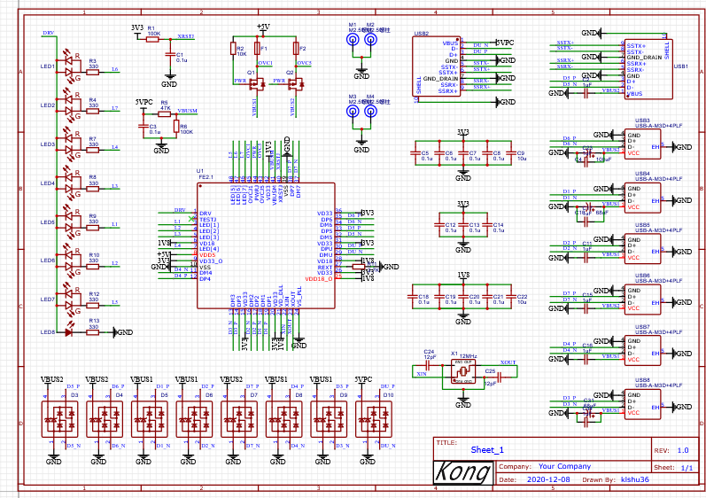 |

| fe2.1 pinout from the datasheet |
| --- |
| 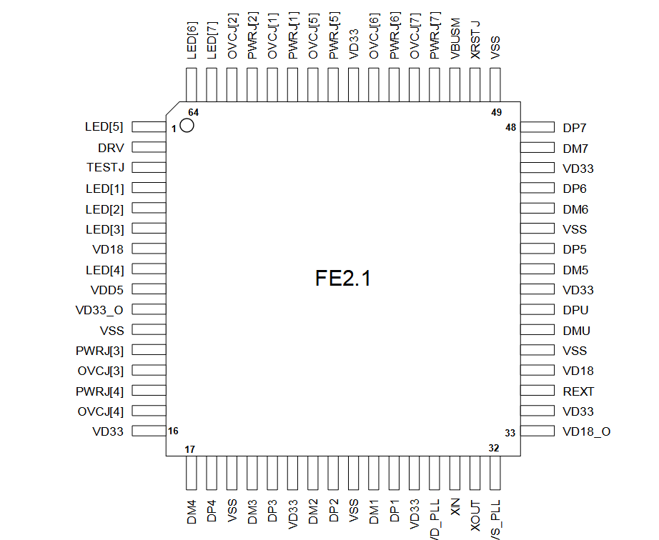 |

48 pins, and a lot of them have weird names like OVCJ, PWRJ and VBUSM, took a while to figure out what they all mean

--- 

### journal #2 first draft  
time spent : 2.5 hours   

  
did a first full draft of the schematic to see how everything fits together. split it into sections for the upstream port, the hub chip, the power switching and the downstream ports  
  

  
| first draft |
| --- |
| 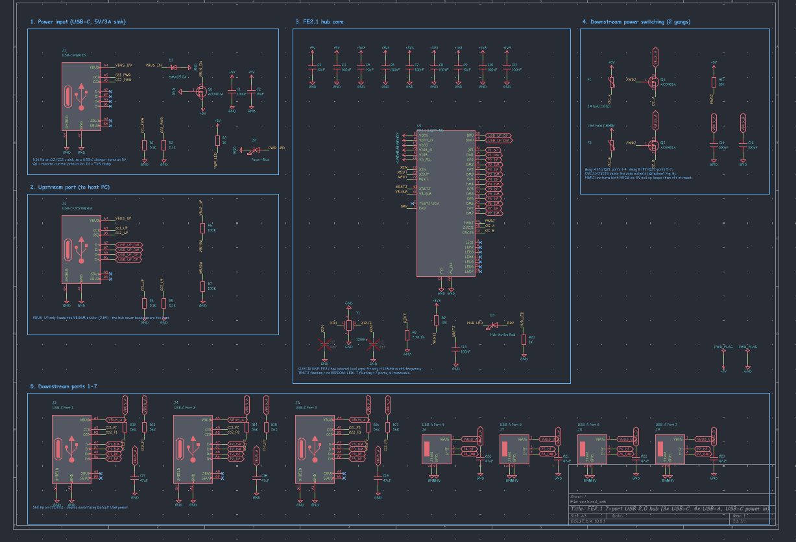 |

it kinda worked but it was messy and i wasnt happy with the hub symbol i was using, the pins were all over the place and hard to follow

--- 

### journal #3 making my own fe2.1 symbol  
time spent : 1.5 hours   

  
so i made my own symbol for the fe2.1 in the kicad symbol editor, going through the pinout one pin at a time and grouping them so the power pins, led pins, usb pins and the power switch pins are together. 48 pins by hand is a lot of clicking lol
  

  
| my fe2.1 symbol |
| --- |
| 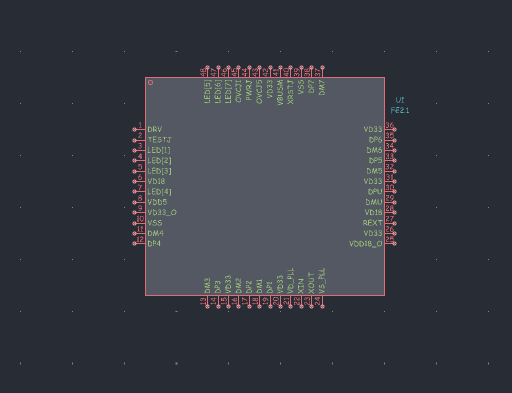 |

--- 

### journal #4 starting over  
time spent : 1.5 hours   

  
started the schematic again from scratch with the new symbol. placed the hub chip in the middle, the usb c upstream port, the 3 usb c and 4 usb a downstream ports so i could see everything before wiring it up
  

  
| starting fresh |
| --- |
| 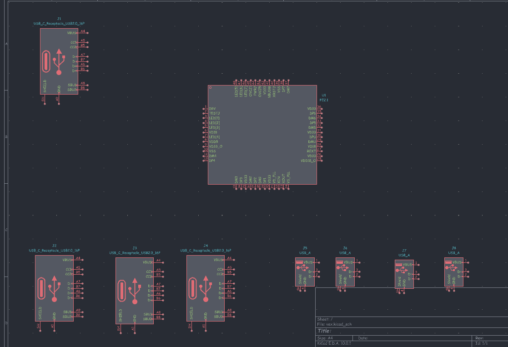 |

--- 

### journal #5 upstream usb c and protection  
time spent : 2.5 hours   

  
the upstream port is the usb c that goes to the laptop. 5.1k resistors on CC1 and CC2 so the laptop turns on vbus, same as always  
  
but this time power matters more because 7 devices are pulling from it, so i added:
- an SMAJ5.0A tvs diode to clamp any voltage spikes on vbus
- an AO3401A p-mosfet as reverse current protection, so if something on a downstream port tries to push power back it doesnt go into my laptop
- 100uF and 10uF bulk caps on the 5v rail
- a blue power led  

this hub is bus powered, so all 7 ports share whatever the laptop port can give
  

  
| upstream port |
| --- |
| 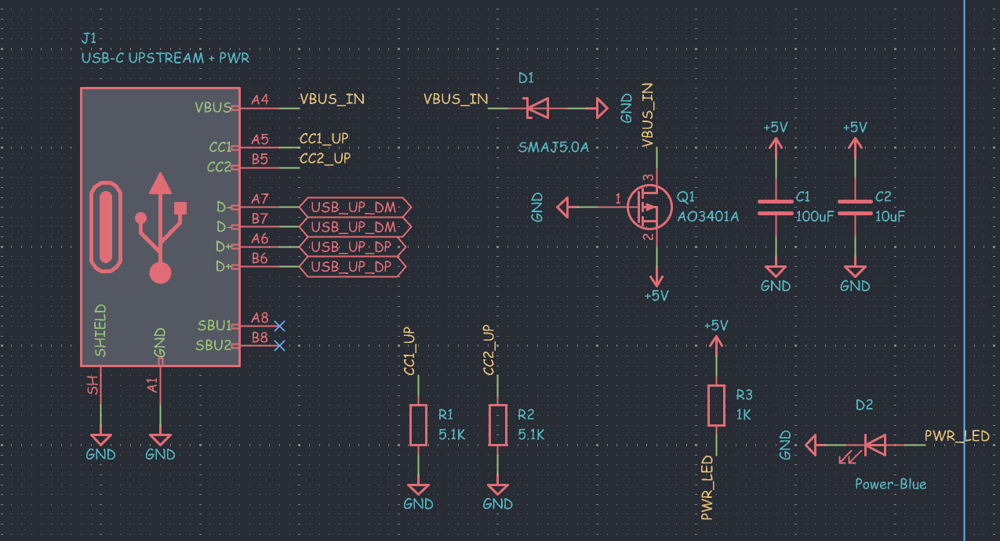 |

--- 

### journal #6 the hub core  
time spent : 4 hours   

  
now the main part, wiring up the fe2.1. every downstream port gets its own DP and DM pair going to a label, and the upstream pair goes to the usb c  
  

  
| fe2.1 wired up |
| --- |
| 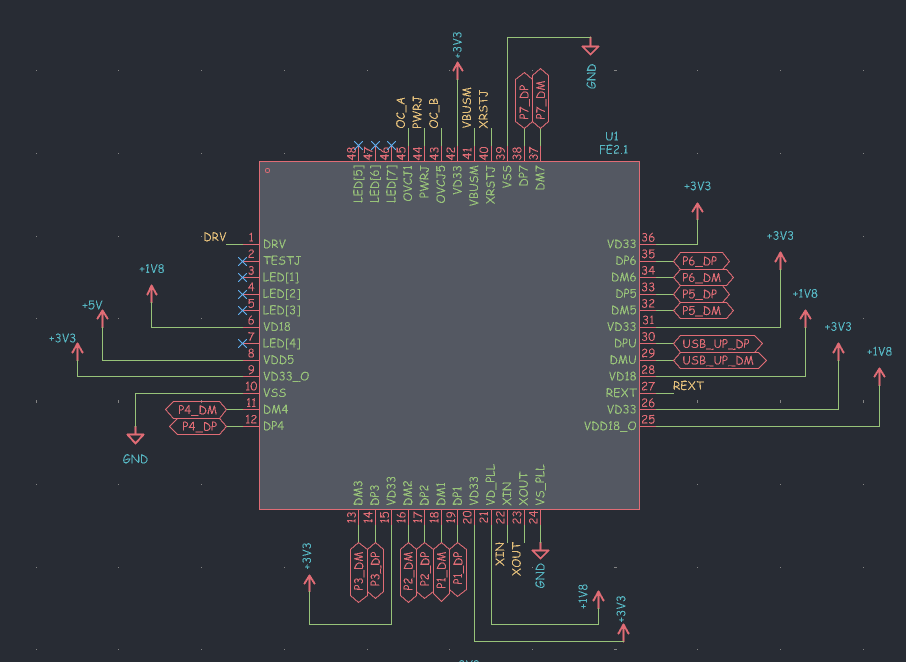 |

it has 3 different power rails, 5v in, 3.3v and 1.8v from its own internal regulators, and each one needs a 10uF and 100nF cap close to the pin

  
| decoupling |
| --- |
| 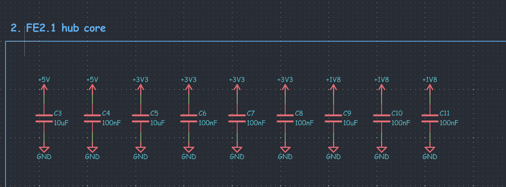 |

other stuff i learned from the datasheet:
- it needs a 12MHz crystal. it has internal load caps so i made the two 18pF caps "do not populate", only fit them if the clock is off
- REXT needs a 2.7k 1% resistor, the chip uses it as a reference for the usb signals so it has to be accurate
- VBUSM needs a 100k / 100k divider from 5v so it sees 2.5v and knows when the laptop is plugged in
- leaving the TESTJ pin floating means no eeprom, and leaving the LED pins floating means all 7 ports are on

--- 

### journal #7 downstream ports and power switching  
time spent : 4 hours   

  
this part took a while to get right. instead of all 7 ports just sharing 5v directly, the ports are split into 2 groups:
- group A, ports 1 to 4, with a 2A polyfuse and an AO3401A switch
- group B, ports 5 to 7, with a 1.5A polyfuse and another AO3401A  

the fe2.1 turns the mosfets on with its PWRJ pins, and a pullup keeps them off while it starts up. the OVCJ pins watch the fuse outputs so if something shorts, the hub knows about it  
  
every downstream port gets a 47uF cap on its vbus so plugging something in doesnt make the voltage dip for everything else. the 3 usb c downstream ports get 56k pullups on CC1 and CC2, which tells the device "im a normal usb power source" (the opposite of the 5.1k on the upstream port). ran erc at the end and fixed the last few warnings
  

  
| the full schematic |
| --- |
| 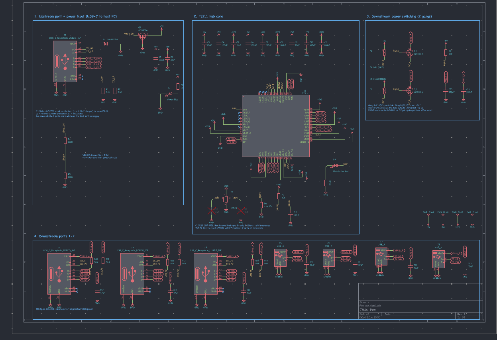 |

--- 

### journal #8 round board and placement  
time spent : 3.5 hours   

  
the fun part!! made the board a circle, 70mm across, and placed the 7 downstream ports all around the edge, usb c and usb a alternating so it looks cool from every side. the upstream usb c is on the edge too  
  
then the fe2.1 right in the center so the usb lines to every port are about the same length. crystal and decoupling caps right next to it, and the fuses and mosfets for each group between the chip and their ports. this is a 4 layer board so i had more room to work with
  

  
| placement |
| --- |
| 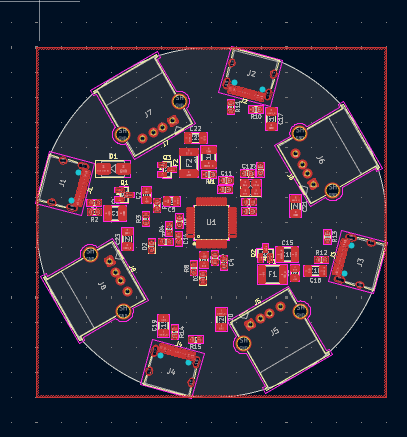 |

placing parts on a circle is so much harder than a rectangle, nothing snaps to the grid nicely

--- 

### journal #9 routing the usb lines  
time spent : 3.5 hours   

  
started routing with the usb data pairs since those are the most important. 8 pairs in total (1 upstream and 7 downstream), each D+ and D- running together from the hub chip out to its port. kept them short and avoided vias on them as much as i could  
  
the area around the chip is super packed, the crystal and caps are right there too
  

  
| around the hub chip |
| --- |
| 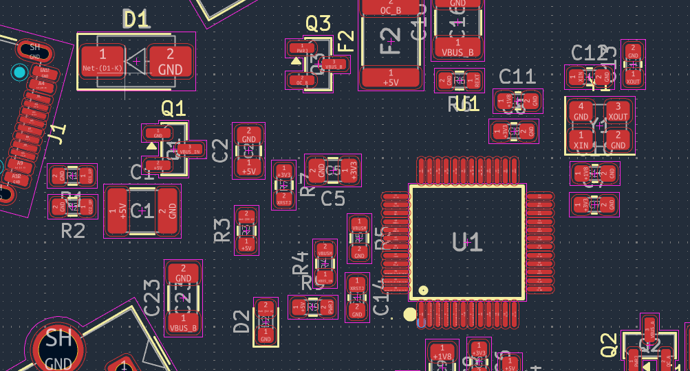 |

--- 

### journal #10 routing power and everything else  
time spent : 3 hours   

  
then the power. made the vbus traces 0.8mm wide since they carry the current for all the ports, from the upstream port through the protection, then the fuses and mosfets out to each group. then all the small stuff, the crystal, REXT, VBUSM divider, leds and the power switch control lines
  

  
| fully routed |
| --- |
| 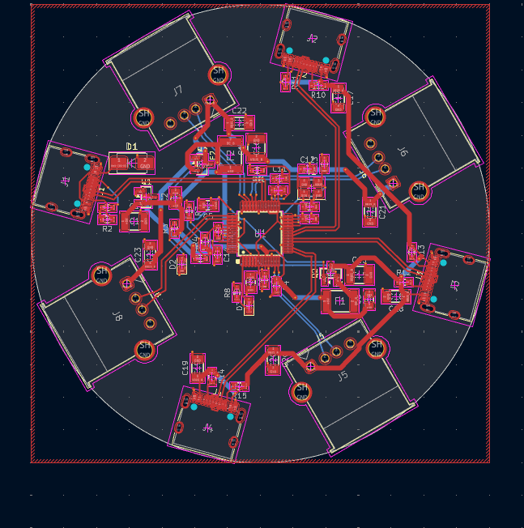 |

--- 

### journal #11 4 layers, pours and drc  
time spent : 3.5 hours   

  
same stackup as my other 4 layer boards. ground fills on top and bottom, a solid ground plane on inner 1 and a 3.3v plane on inner 2. the ground plane right under the usb pairs keeps them clean  
  

  
| ground pour |
| --- |
| 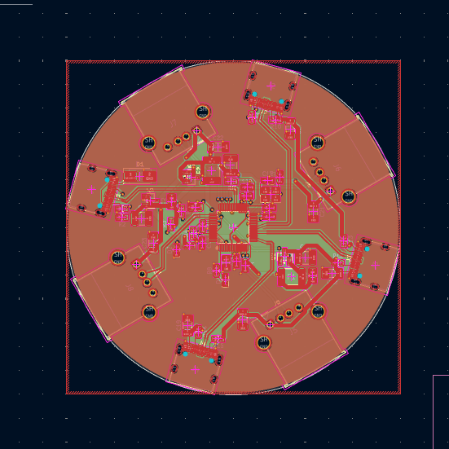 |

then stitching vias all around the board to connect the grounds, 107 vias in the end. ran drc a bunch of times and fixed everything it complained about, mostly clearance stuff near the usb a connectors and the chip

--- 

### journal #12 renders  
time spent : 2 hours   

  
checked everything in the 3d viewer and took renders. the black board with the white usb c and grey usb a ports all around it looks so good, kinda looks like a little spaceship lol
  

  
| front | top |
| --- | --- |
| 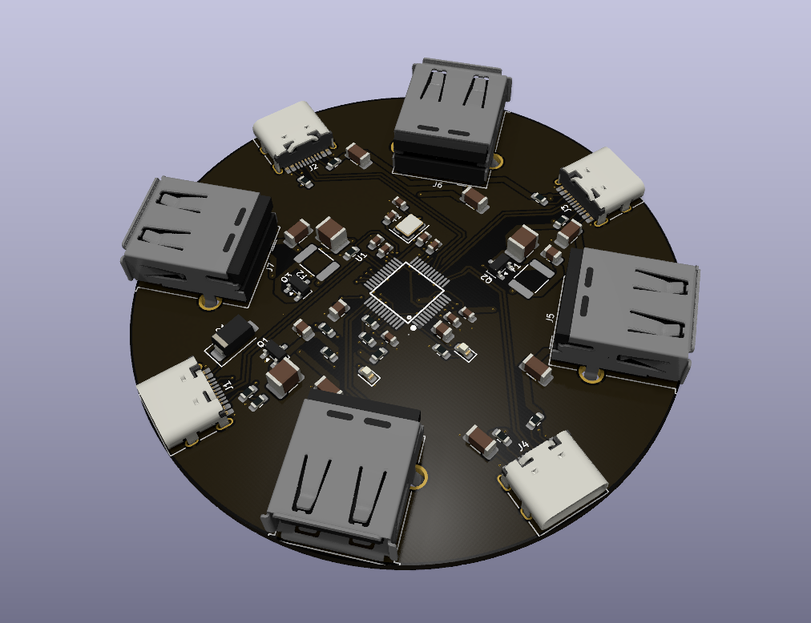 | 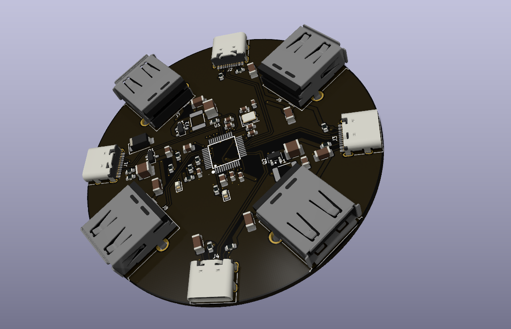 |

| back |
| --- |
| 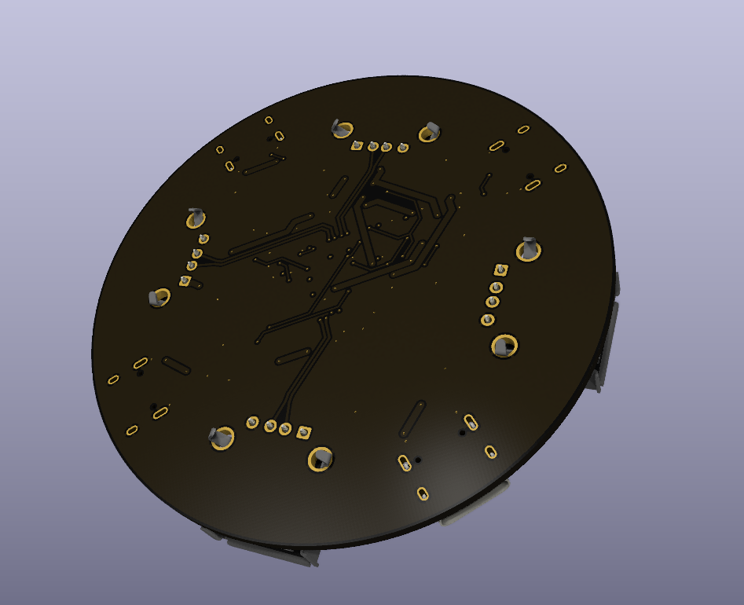 |

--- 

### journal #13 making the zine  
time spent : 2 hours   

  
made a zine for vex in canva. blue and white background with some cream shapes and sparkles, big distressed VEX letters at the top, the render in the middle and "the perfect usb-hub" on the sides. also put that its using the fe2.1s ic at the bottom. took a few tries to get the render to sit nicely between the shapes
  

  
| the zine |
| --- |
| 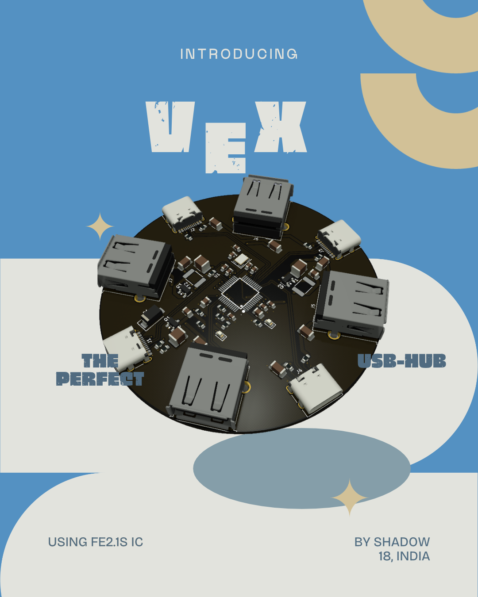 |

--- 

### journal #14 bom, readme and production files  
time spent : 2 hours   

  
last bit! exported the gerbers, drill files, bom and position files for jlcpcb. got the quote for pcba on 2 boards and it was 35.70$, which is honestly really cheap for a 4 layer board with 7 ports all assembled. made the bom.csv, wrote the readme and uploaded everything to github
  

  
| vex |
| --- |
| 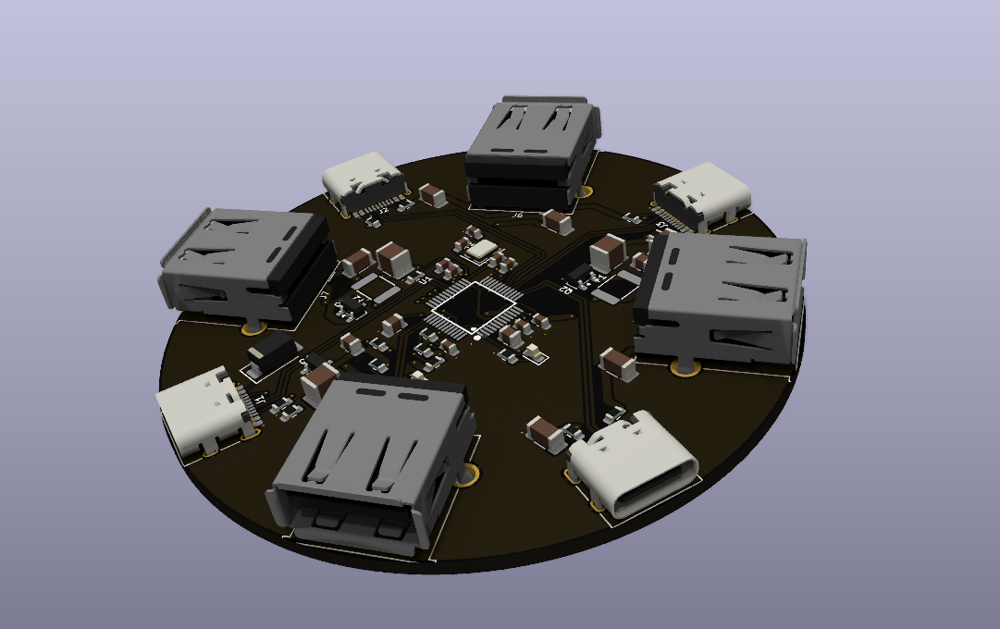 |

thats vex done! if you read till here, thank you :D
