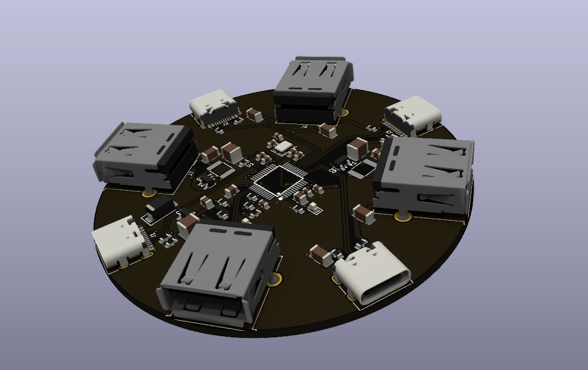
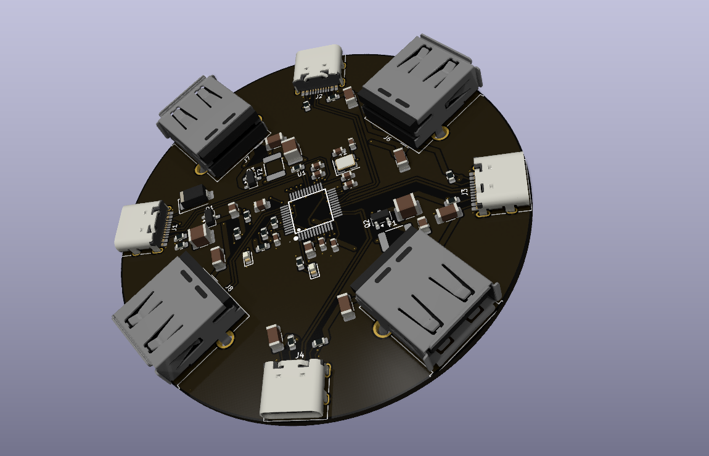
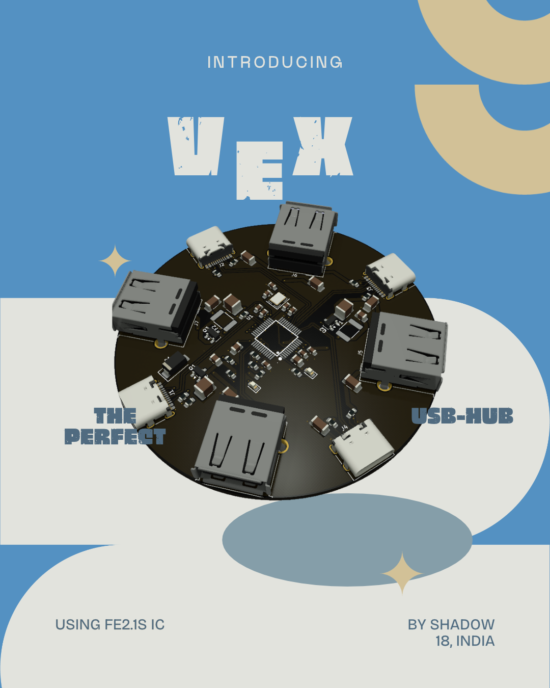
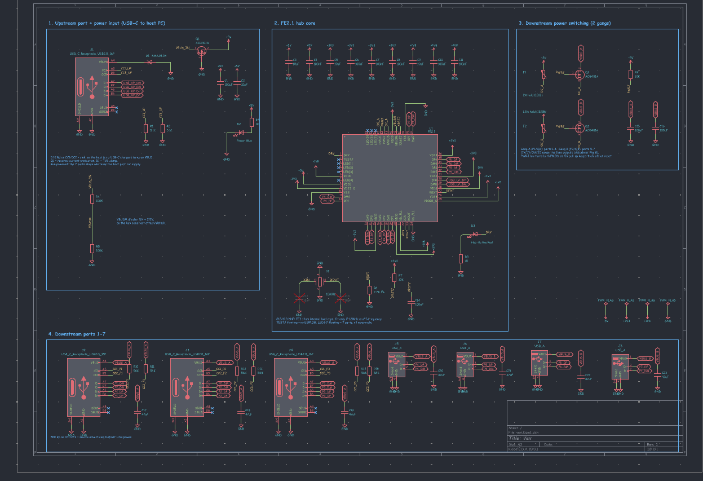
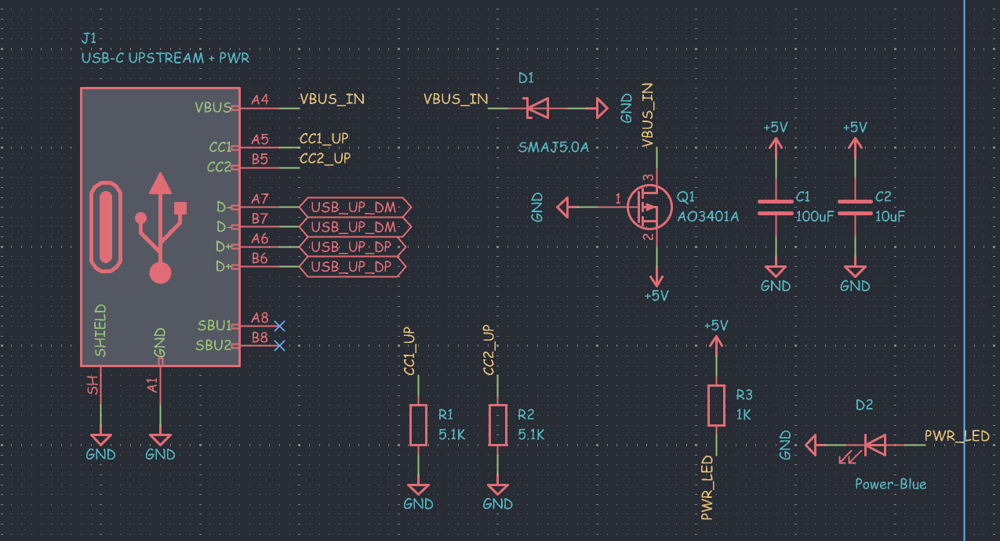
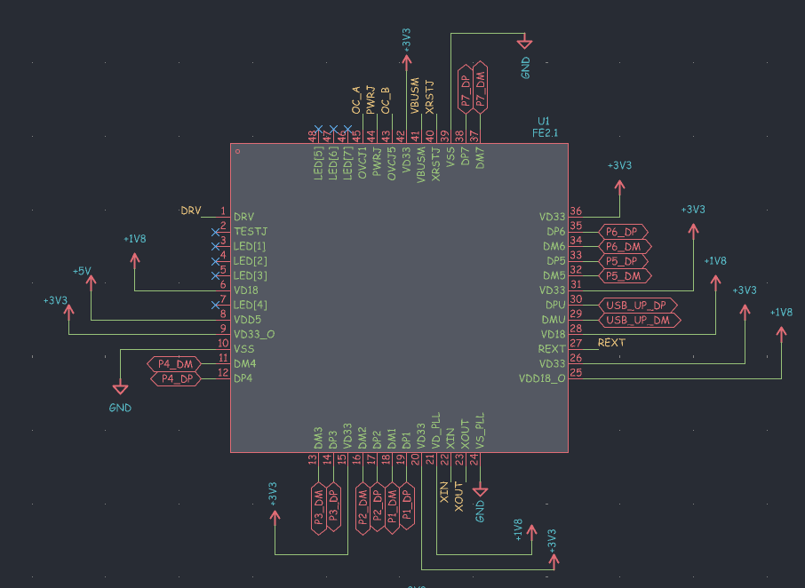
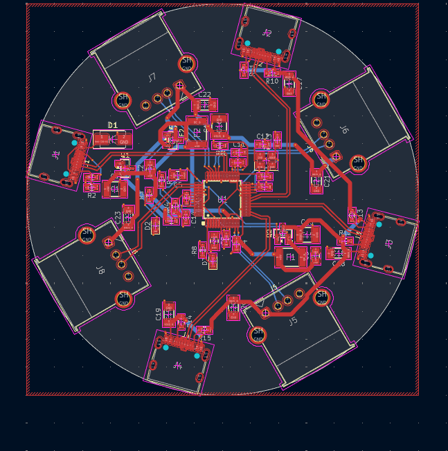
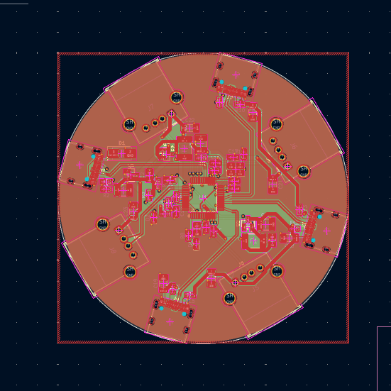
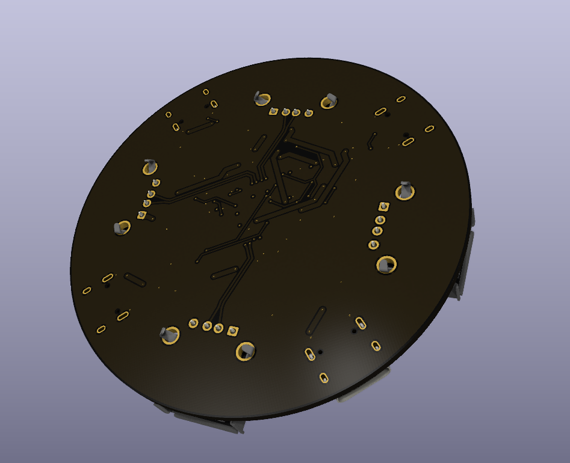

<h1 align="center">
 

 
Vex
 
</h1>

<h3 align="center">

A round 7 port USB hub :D

</h3>

  
  

Vex is a USB 2.0 hub built around the FE2.1 chip. You plug it into your laptop with one USB-C cable and it gives you 7 ports around the edge, 3 USB-C and 4 USB-A. The board is a 70 mm circle with 4 layers, cause I didn't want another boring rectangle hub.

The whole design process is in [JOURNAL.md](JOURNAL.md), it took me around 39 hours.

## Features

- FE2.1 USB 2.0 hub chip with 7 downstream ports
- 1 USB-C upstream port, 3 USB-C and 4 USB-A downstream ports
- Ports split into 2 power groups, each with its own polyfuse (2A and 1.5A) and an AO3401A power switch controlled by the hub
- Overcurrent sensing, so the hub knows if a port shorts
- SMAJ5.0A TVS diode and reverse current protection on the input
- 47uF cap on every downstream port so plugging something in doesn't dip the others
- 56k CC pullups on the USB-C downstream ports so phones and other USB-C devices get power
- Blue power LED and red hub active LED
- Bus powered, all ports share what the laptop port gives

## Ports

| Port | Type | Power group |
| --- | --- | --- |
| Upstream | USB-C | Input from laptop |
| 1 to 4 | Downstream | Group A, 2A fuse |
| 5 to 7 | Downstream | Group B, 1.5A fuse |

## Schematic

| Full schematic |
| --- |
|  |

| Upstream port | Hub chip |
| --- | --- |
|  |  |

## PCB

| Routed | Ground pour |
| --- | --- |
|  |  |

The FE2.1 sits in the middle so the USB lines to every port are about the same length. Top and bottom have ground fills, inner 1 is a ground plane and inner 2 is a 3.3V plane. The power traces are 0.8 mm and there are 107 vias stitching it all together.

| Back |
| --- |
|  |

## Why was it made?

My laptop only has 2 USB ports and I'm always running out. So I made my own hub, and made it round so it actually looks cool on my desk :D

## BOM

| Item | Qty | Price ($) | Vendor |
| --- | --- | --- | --- |
| PCBA (2 boards) | 1 | 35.70 | JLCPCB |
| Total | | 35.70 | |
